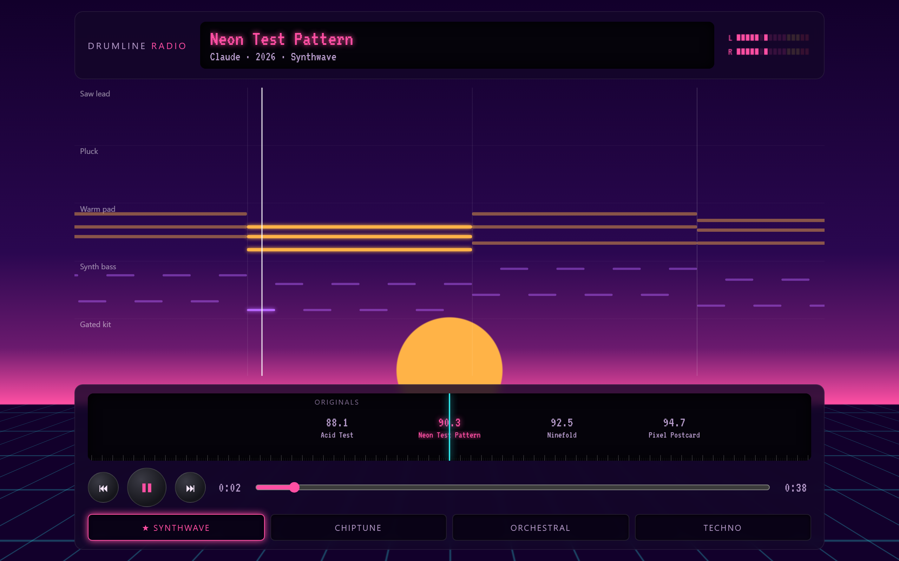
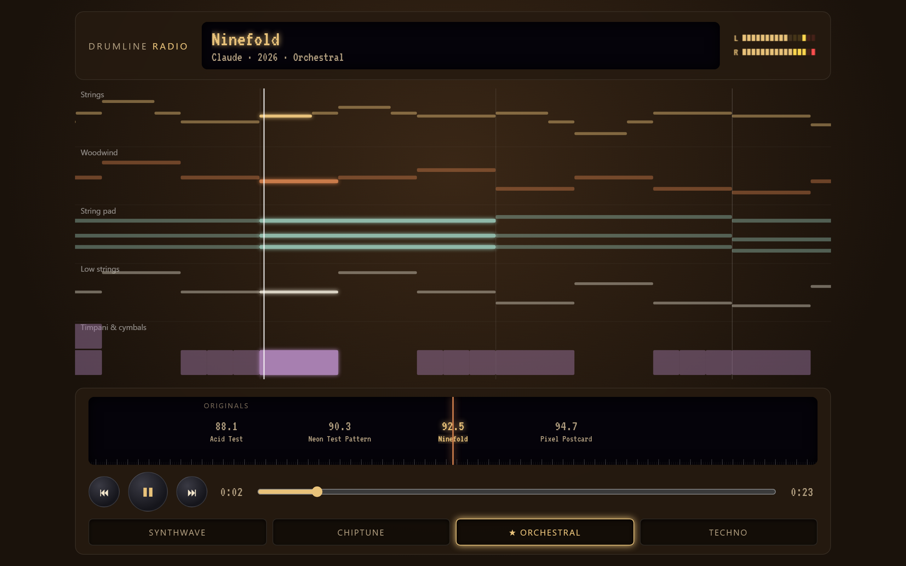
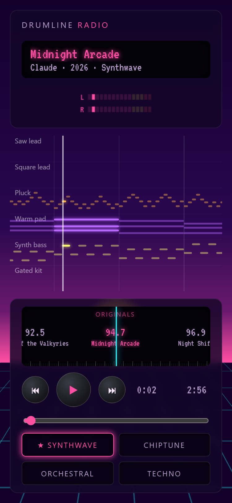

# Drumline Radio

A browser jukebox for full songs written as text scores: public-domain melodies arranged by
SZ and AI, and their own originals. It is the sibling of
[Drumline Studio](https://stansz.github.io/drumline-studio/).

**Play it:** https://radio.ogsapps.cc/ (mirror: https://stansz.github.io/drumline-radio/)



It looks like a hi-fi radio tuner and plays the songs with a Web Audio synth:

- A tuner dial of stations, one per song, with a fixed needle that snaps to the nearest one.
- Category presets (All, Classics, Originals, Carols) above the dial show just that group of stations (remembered between visits).
- Within each category the dial is grouped by home style, with a caption at the start of each style. The style button next to the presets opens a Filter menu of the styles that category has (G cycles through them), showing only that style's songs; the playlist's library list has the same button.
- A Playlist view (Radio | Jukebox | Playlist switch in the header): add any song in any of the 8 styles, the same song more than once, reorder or remove entries, and play the list in order, with a Loop toggle. The playlist is saved on this device.
- A Jukebox view: the original songs as a wall of coded title strips, grouped by style or by composer. Tap a strip to play that song in its home style, and + adds it to the playlist.
- Share links: in the song card (tap the song title), "Share song" shares the song in the style you are hearing, and "Share from m:ss" adds the current time; the playlist view's Share button shares the whole list. Opening a link tunes the app, ready to play; a shared playlist asks before replacing or adding to yours. Uses the share sheet where the browser has one, otherwise copies the link. The song card also has "Save as WAV", which renders the song in the style you are hearing and downloads it (about 10 MB a minute; rendering takes roughly a quarter of the song's length, longer on a phone; the button shows the percent done, or the seconds so far in browsers that can't report progress).
- Instrument page: `instruments.html` (not linked from the radio) lists every instrument in the synth bank; click one to hear a short phrase in a style that uses it, or pick another style's room.
- Installable and works offline: install it from the browser (or the Install button where offered; on iPhone, Share → Add to Home Screen). It checks for an update each time it opens or comes back to the front, and a new version takes over right away (if music is playing, the next time you switch away from it). The bottom of the ⓘ panel shows the build's commit and time, so you can check which version is running.
- A living score that scrolls each track's notes past a playhead. Drag it sideways to scrub through the song.
- VU meters, a glowing readout, and a volume slider with mute (remembered between visits).
- A repeat button that loops the current song (remembered between visits).
- Long titles scroll in the readout. Tap the readout for a song card: credits, key, tempo, length, and a short story for each public-domain song.
- An ⓘ panel with dim view and a black screensaver (auto-starts after 1 or 5 minutes without a touch) to save battery. The screen stays awake whenever music plays. Phones pause the live synth when the app is minimized, so keep it open.
- Nine styles (Synthwave, Chiptune, Orchestral, Techno, Lo-fi, Cinematic, Alt rock, Ambient, Studio) with remix by band button: switch the band
  and the same notes play with that style's instruments. Ambient is a washed pad, a music box and a soft sub in a long dark reverb, over a bed of air. Studio is the open style: every instrument in the bank, through a clean mix. The styles fold into one button at the end of the transport, labelled with the style you are hearing (plus "remix" when it isn't the song's own); it opens them as a panel headed Style, three by three, with the song's own style starred and the selected one lit in its colour. The 1–9 keys still switch directly. On a phone the seek bar has its own full-width row above the transport.
- Each style has its own full-screen scene behind the player: a neon sunset and grid (Synthwave), an 8-bit night with pixel mountains (Chiptune), an evening concert hall with organ pipes, velvet drapes and drifting dust in the stage light (Orchestral), a warehouse with swaying lasers (Techno), a rainy window over city lights (Lo-fi), a widescreen sunrise over mountains with a lens flare (Cinematic), a brick-walled basement show under one spotlight (Alt rock), and a control room with acoustic panels and an on-air lamp (Studio). The lasers, rain and dust stop with reduced motion.
- Techno flashes the screen gently on the kick, within the WCAG flash limits (at most 3 a second, a soft fade). It is off with reduced motion, and the ⓘ panel has a switch to turn it off.
- Keyboard shortcuts: Space play/pause, ←/→ previous/next station, 1–9 styles, C category, G style filter, M mute, R repeat, S screensaver, J jukebox, P playlist view.

| Orchestral | Phone |
|---|---|
|  |  |

The sound engine, including the instrument bank and its plucked-string guitars, and how to add a
patch or a style, are described in [docs/sound.md](docs/sound.md). To ask another AI model for a new
song, fill in the prompt template in [docs/song-prompt.md](docs/song-prompt.md).

## Songs

Christmas carols, arranged by Claude and SZ:

- **Deck the Halls** (traditional Welsh). Synthwave.
- **God Rest Ye Merry Gentlemen** (traditional English). Techno.
- **Good King Wenceslas** (melody from *Piae Cantiones*, 1582). Chiptune.
- **Hark! The Herald Angels Sing** (Felix Mendelssohn, 1840). Orchestral.
- **Jingle Bells** (James Lord Pierpont, 1857). Chiptune.
- **Joy to the World** (arranged by Lowell Mason, 1839). Orchestral.
- **O Christmas Tree** (traditional German). Orchestral.
- **Silent Night** (Franz Xaver Gruber, 1818). Synthwave.
- **We Wish You a Merry Christmas** (traditional English). Synthwave.

Other public-domain melodies, arranged by Claude and SZ:

- **Greensleeves**, traditional English ballad (16th century). Orchestral.
- **In the Hall of the Mountain King**, from Edvard Grieg's *Peer Gynt* (1875). Chiptune. It speeds
  up from start to finish.
- **Ride of the Valkyries**, from Richard Wagner's *Die Walküre* (1856). Orchestral, in real 9/8.
- **Canon in D** (Johann Pachelbel, around 1680). Orchestral.
- **Clair de Lune** (Claude Debussy, 1905). Cinematic.
- **Für Elise** (Ludwig van Beethoven, 1810). Synthwave.
- **Korobeiniki**, the Tetris tune (Russian folk song, 1861). Chiptune.
- **Moonlight Sonata**, first movement (Ludwig van Beethoven, 1801). Cinematic.
- **Nocturne in E-flat, Op. 9 No. 2** (Frédéric Chopin, 1832). Orchestral.
- **Swan Lake** (Pyotr Ilyich Tchaikovsky, 1876). Orchestral.

Hidden for now, to be redone later: Can-Can, Eine kleine Nachtmusik, Ode to Joy, When the Saints Go Marching In.

Originals by SZ (and AI):

- **Pagoda Rain** (Ambient), by Claude & SZ. An 8:00 ambient piece at 64 BPM in D major, after the music in the Pagoda Garden toy: a washed pad and a soft sub changing chord every fifteen seconds, music-box notes picked from each chord, a slow Rhodes phrase and a rising glass pad in the middle, over the style's bed of air. Loops cleanly with repeat on.
- **Temple Bells** (Ambient), by Claude & SZ. A 7:28 ambient piece at 60 BPM in A minor: a dark pad on Am9, Fmaj7, Cmaj7 and G6, music-box bells, a glass pad and a Rhodes in the middle, and the bed of air. Loops cleanly with repeat on.
- **Exit Sign** (Alt rock), by GPT-6.1-sol & SZ. A 2:57 guitar-band original: palm-muted verses, a twelve-bar vocal-style hook, a half-time bridge, and a final double chorus.
- **A Match in the Static** (Alt rock), by Arena Agent, Claude & SZ. A 3:44, 120 BPM E-minor stomp: eight solo shimmer-guitar bars grow into picked-bass verses with a quiet clean-electric melody and crunchy pre-choruses, then burst into a fuzz-hook/guitar-wall chorus; a quiet bridge rebuilds into a final double chorus and a ringing E-minor outro.
- **Porch Light** (Alt rock), by Grok, Claude & SZ. A 4:40 slow, emo indie original at 72 BPM: a laid-back clean electric guitar lead, shimmering arpeggios, a Ben Folds-style piano, a borrowed minor iv in the hook, and a half-time bridge in a new key before the last chorus finally gets loud.
- **Ivory and Ash** (Cinematic). A 128 BPM club mix, Ivory and Ash (128 Mix), is hidden for now.
- **The Silent Keep** (Cinematic), by DeepSeek V4 Flash & SZ. A 6:06 heavy-metal ballad-epic in E minor:
  a clean guitar and solo cello state the theme, the band kicks into a Phrygian gallop, twin guitars
  trade thirds and sixths, a 48-bar solo climbs through sixteenth and sextuplet runs to a held, bent
  high E, and the fire dies back to a lone cello.
- **Lantern Ward** (Orchestral). A nocturne in D minor whose recapitulation reassembles the theme as a hocket while the violins rest.
- **The Cartographer** (Orchestral). An A-major overture whose cello-led middle section stretches the theme between illuminated chord windows.
- **Last Stop** (Lo-fi)
- **Midnight Arcade** (Synthwave), by Claude, MiMo v2.6 Pro & SZ. A 3:36 synthwave original at 98 BPM in E minor, built around its
  saw lead and melody: the chorus hook opens the song bare with a dotted-eighth delay, the verses keep
  the arp out of the melody's way while a counter-line answers under it, the choruses double the
  melody an octave down over ghost-noted drums and a bass that ducks the sub on every kick, a
  sixteen-bar solo takes the verse changes in sixteenths, triplets and bends, and the breakdown and
  the outro leave the melody alone with its delay.
- **Starlight Drive** (Synthwave), by Ling 3.1 Flash & SZ. A 4:04 italo-disco original at 118 BPM in
  Bb major: a wordless vox-lead hook over four-on-the-floor gated drums, an octave-bouncing bass,
  bright offbeat stabs, a shimmer-guitar arp, a saw riff, and ooh and aah choirs that trade bars in
  the verses and sing together in the choruses, with a kick-less breakdown and a last chorus up a
  whole step.
- **Sunliner** (Synthwave), by Arena Agent & SZ. A 4:04 italo-disco original at 118 BPM in D major:
  a wordless vox-lead hook answered by a saw lead between phrases, four-on-the-floor gated drums
  with open hats on the off-beats and claps on two and four, an octave-bouncing eighths bass, bright
  poly-stab chords, a pluck arp, ooh under the verses and aah lifting the choruses, a kick-less
  breakdown where the choirs and pad carry the hook, and a last chorus up a whole step to E.
- **Fathom** (Techno), by Qwen3.8 Flash & SZ. A 5:09 dub techno original at 118 BPM in G minor: one
  chord stab and nothing else melodic, voiced eight ways, its repeats written as extra stabs that
  land later and softer each time. It opens on the lone echoing chord with no kick, builds a rumbling
  sub, hiss hats and a second high stab layer over 16-bar stages, drops the kick for a breakdown where
  the chord hangs in the pad, comes back widest, then strips down to the stab alone in the dark.
- **Night Shift** (Techno)
- **Riverfront** (Techno), by MiMo v2.6 Pro & SZ. A 4:23 deep techno original at 124 BPM in F minor:
  it opens with no kick (a pad, then a hypnotic FM counter-line) before the kick and a rolling sub
  bass drop in together; warm chord stabs, a breakdown where the kick drops and the hook surfaces
  over the pad and chords, and two drops.
- **Signal Fire** (Techno), by MiniMax M3.1 Flash & SZ. A 4:07 peak-time techno original at 132 BPM
  in F# minor: a 16-bar drums-and-bass intro, a groove that adds the chord stabs, a breakdown where
  the kick drops and a chopped wordless vocal hook carries over a dark pad, a snare-roll build into
  the first drop, a short second breakdown, a bigger build, a 32-bar final drop with the hook
  doubled an octave up, and a 16-bar outro for the mixer.
- **Hot Wire** (Techno), by GLM 5.3 & SZ. A 4:30 peak-time electro-house original at 128 BPM in
  A minor: one gritty octave-bouncing riff on the acid lead (pairs of staccato sixteenths, an
  octave pop, and a cheeky ninth) carries the song over Am-F-C-G. A DJ intro of kick, hats and a
  sub locked to the kick filters the riff in, off-beat stab skanks and swung open hats build the
  first groove, a snare-roll build drops into the full kick-and-stabs section, and after a second
  breakdown where a chopped wordless vocal sings over the pad, the final drop runs 32 bars with
  vocal chops, a rolling sub with octave pops, 16th hats, and the riff doubled an octave up for the
  last 16 bars before a stripped outro.
- **Dusk Over Dunmere** (Chiptune), by MiMo v2.6 Pro & SZ. A 3:04 wistful fantasy RPG theme at
  88 BPM in 3/4: a singing pulse lead with long held notes over rolling pulse-arp broken chords in
  place of drums, a walking triangle bass, a square counter-melody answering the lead's holds,
  square pad fifths holding the bigger moments, a lift to F major that builds with a light march
  snare, a quiet bridge of just arp and bass, a last statement up a step in E minor, and an outro
  that ritards down to the lone arp.
- **Save Point** (Chiptune)
- **Shortwave** (Lo-fi)
- **Third Rail** (Lo-fi)
- **Underpass** (Synthwave). Hidden for now, with Midnight Underpass, a medley of it and Midnight
  Arcade.
- **Wayfarer's Rest** (Chiptune), by Gemini 3.8 Flash & SZ. A 3:19 wistful fantasy RPG theme at 88 BPM in 3/4: a singing pulse lead over rolling pulse-arp broken chords in D Dorian, a walking triangle bass, an answering square counter-melody, a warm major-key lift in F, a quiet bridge, a final heroic statement up a step in E minor, and an outro that winds down to the lone arp.

## How it works

The one-page overview: [docs/how-it-works.md](docs/how-it-works.md).

## Song format

Each song is one plain-text file. See [docs/song-format.md](docs/song-format.md).

## Commands

```bash
npm install
npm run dev
npm test
npm run typecheck
npm run build
npm run check:songs
npm run balance -- <song>
```

Dev tools (the song arranger and browser checks) are described in [tools/README.md](tools/README.md).

## License

MIT. See [LICENSE](LICENSE).
